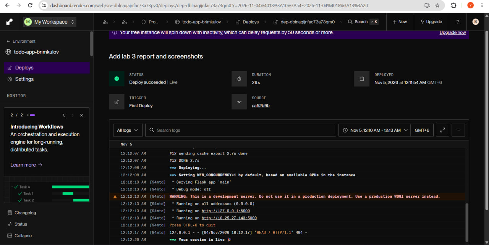
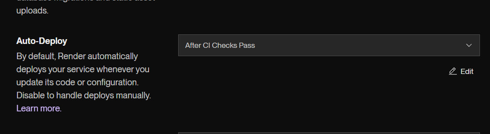
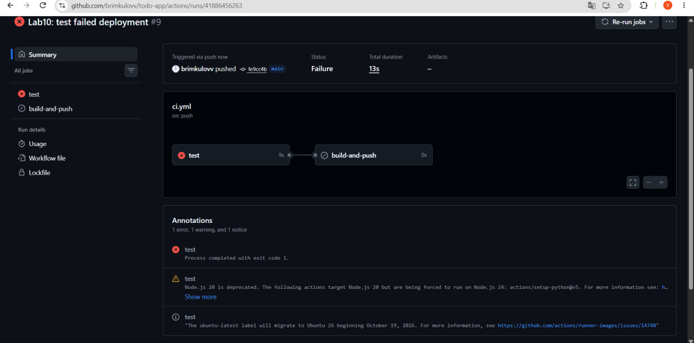
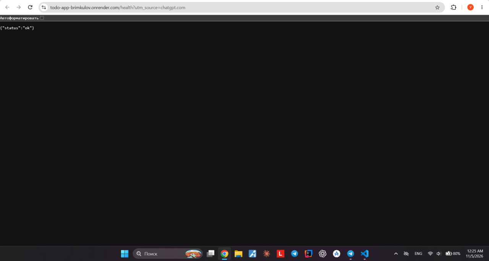
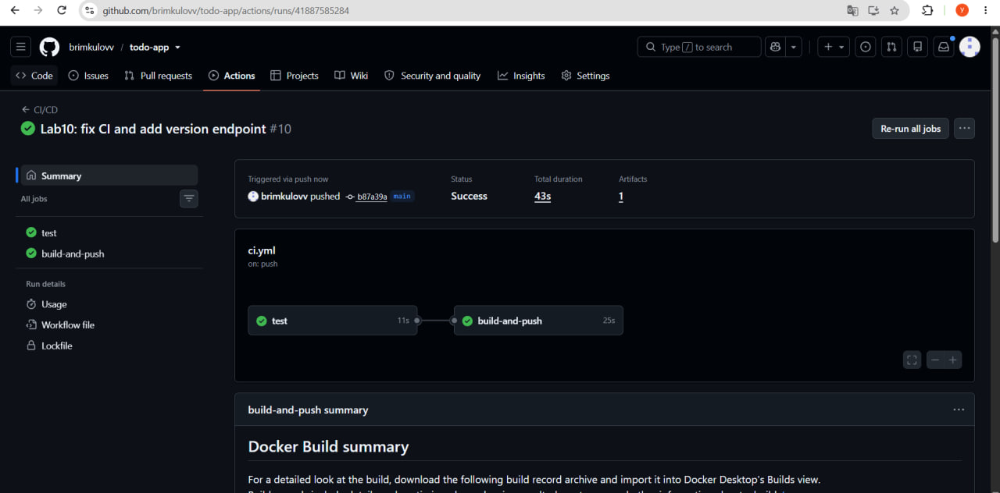
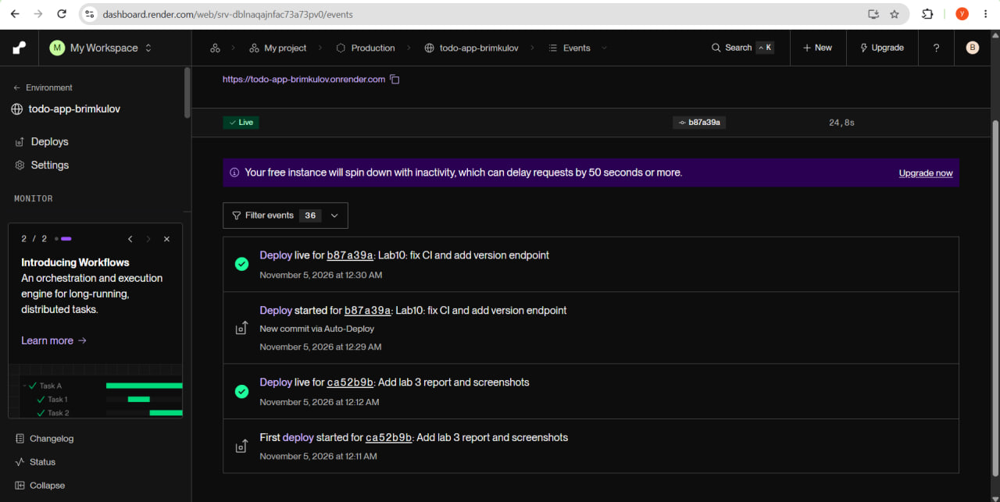
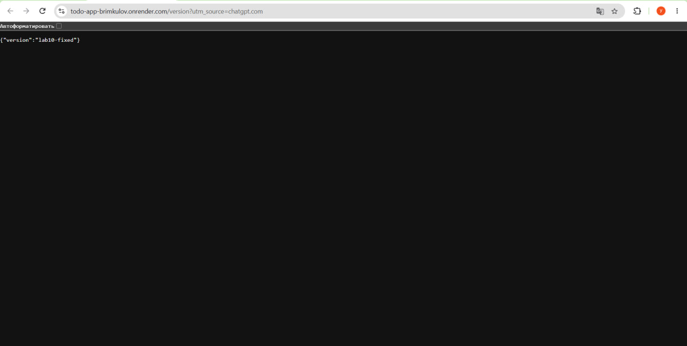

# Lab 10 — PaaS Deployment with Render

## 1. Objective

Deploy a Flask ToDo application to a PaaS platform with a public HTTPS endpoint and automatic deployments that occur only after successful CI checks.

## 2. Platform

**Selected platform:** Render

**GitHub repository:** https://github.com/brimkulov/todo-app

**Public application:** https://todo-app-brimkulov.onrender.com

**Health endpoint:** https://todo-app-brimkulov.onrender.com/health

Render was selected because it provides Docker deployment, HTTPS, automatic deployment from GitHub, and integration with CI checks.

## 3. Initial Deployment

The Flask application was connected to Render using the GitHub repository.

Configuration:
- Runtime: Docker
- Branch: main
- Port: 5000
- Health endpoint: /health

The application was successfully deployed and returned:

`{"status":"ok"}`

## 4. CI-Based Deployment Protection

In Render settings, the following option was enabled:

**Auto-Deploy: After CI Checks Pass**

This setting prevents automatic deployment when GitHub CI checks fail.

Official documentation:

https://render.com/docs/deploys#configuring-auto-deploys

## 5. Failed CI Experiment

The `/health` endpoint was intentionally modified to return `BROKEN` instead of `ok`.

The existing pytest test expected `ok` and therefore failed.

GitHub Actions detected the error.

The failing commit was not automatically deployed to Render. The public application continued returning the previous working response.

## 6. Successful CI and Deployment

The `/health` endpoint was restored to return `ok`.

A new endpoint, `/version`, was added to verify that a new application version was deployed.

The corrected commit passed the GitHub Actions checks.

Render then automatically deployed the updated application.

The new public endpoint returned:

`{"version":"lab10-fixed"}`

## 7. Conclusion

The Flask application was successfully deployed to Render and made available through HTTPS.

The Auto-Deploy setting was configured to deploy only after successful CI checks.

The experiment demonstrated that a failing CI check prevented automatic deployment, while a corrected commit was successfully deployed.

## 8. Final Links

**GitHub:** https://github.com/brimkulov/todo-app

**Application:** https://todo-app-brimkulov.onrender.com/health

**Updated version:** https://todo-app-brimkulov.onrender.com/version

**Render documentation:** https://render.com/docs/deploys#configuring-auto-deploys