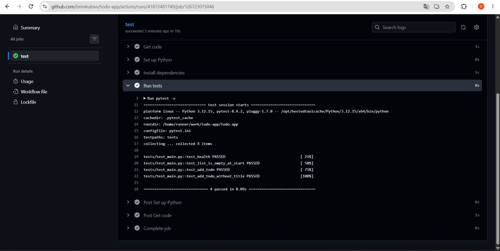
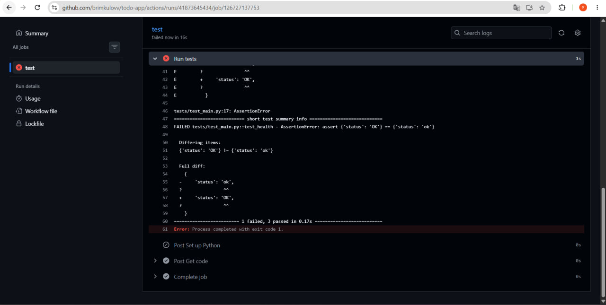
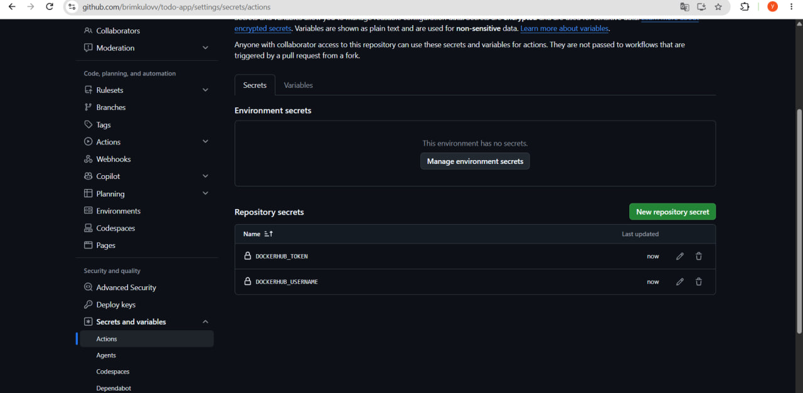
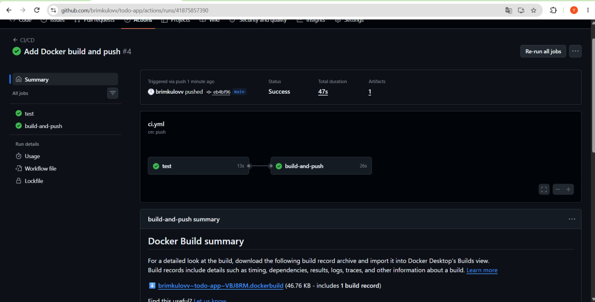
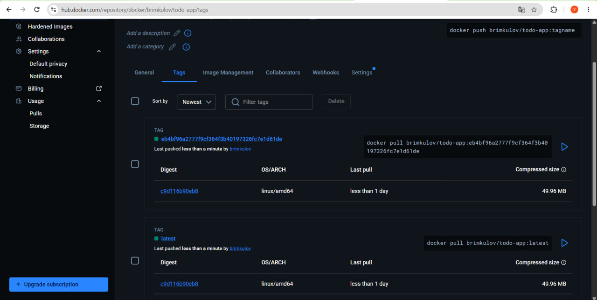
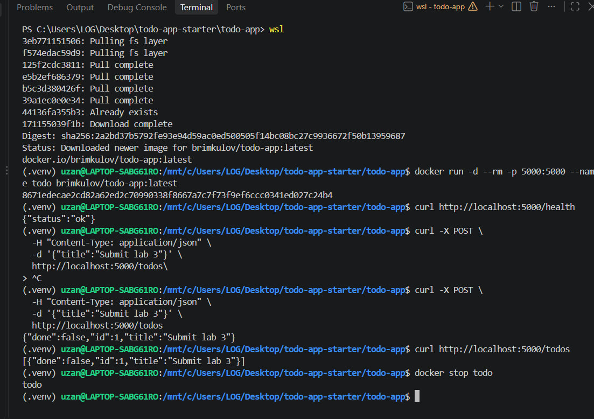
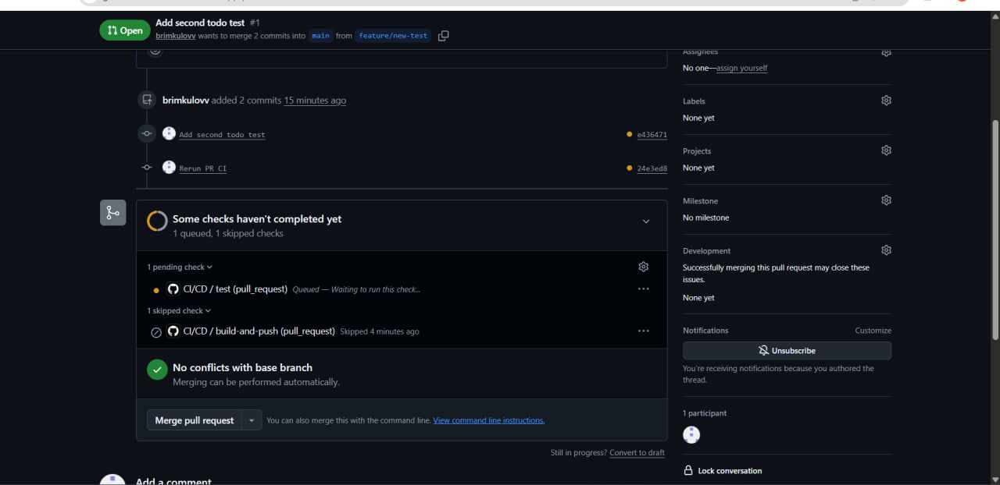
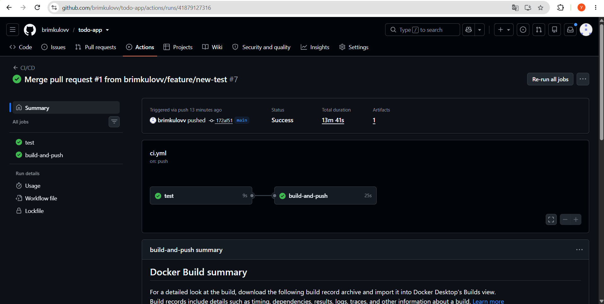

# Lab 3 — CI/CD with GitHub Actions

## 1. Objective

The objective of this laboratory work is to implement a CI/CD pipeline using GitHub Actions, automated testing with pytest, and Docker image publishing to Docker Hub.

## 2. Technologies

- Python and Flask
- pytest
- Git and GitHub
- GitHub Actions
- Docker
- Docker Hub

## 3. Implementation

### Part 1 — GitHub Repository

The starter Flask ToDo application was uploaded to GitHub.

Repository: https://github.com/brimkulov/todo-app

### Part 2 — Continuous Integration

A GitHub Actions workflow was created in `.github/workflows/ci.yml`.

The workflow automatically installs Python dependencies and executes pytest tests.

### Part 3 — Failed Test Demonstration

The `/health` endpoint was intentionally changed to return `ERROR` instead of `ok`.

The automated test detected the incorrect response. After fixing the application, the tests passed successfully.

### Part 4 — Docker Hub Authentication

Two GitHub Secrets were configured:

- DOCKERHUB_USERNAME
- DOCKERHUB_TOKEN

### Part 5 — Docker Build and Push

The CI/CD pipeline was extended to build a Docker image and publish it to Docker Hub after successful tests.

The image was published using `latest` and commit SHA tags.

### Part 6 — Docker Container Verification

The published Docker image was downloaded and launched locally.

The `/health` endpoint returned:

`{"status":"ok"}`

The `/todos` endpoint successfully created and returned a ToDo item.

### Part 7 — Pull Request

A new test was added in the `feature/new-test` branch.

A Pull Request was created to merge this branch into `main`.

The `build-and-push` job was correctly skipped during the Pull Request.

The `test` job remained pending because GitHub Actions did not complete the run. An attempt to cancel the workflow returned: `Cannot cancel a workflow run that is not in progress`.

The test results should be verified separately using local pytest execution.

### Part 8 — Merge

The Pull Request was merged into the main branch.

## 4. Questions

**Q1: Which test failed and why?**

The `test_health` test failed because the expected status was `ok`, but the application returned `ERROR`.

**Q2: Why was build-and-push skipped during the Pull Request?**

The workflow includes a condition that allows Docker image publishing only from the main branch and excludes pull request events.

**Q3: Why use SHA tags instead of only latest?**

SHA tags identify an exact version of the source code. They make it easier to trace releases and roll back to previous versions.

## 5. Conclusion

The CI/CD workflow was configured to run automated tests, build Docker images, and publish them to Docker Hub.

The published application was successfully tested in a local Docker container.

The Pull Request publishing condition worked correctly. The Pull Request test execution encountered a pending GitHub Actions run, which was documented separately.

## 6. Links

GitHub Repository: https://github.com/brimkulov/todo-app

Pull Request: https://github.com/brimkulov/todo-app/pull/1

Successful GitHub Actions Run: https://github.com/brimkulovv/todo-app/actions

Docker Hub Repository: https://hub.docker.com/repository/docker/brimkulov/todo-app/general